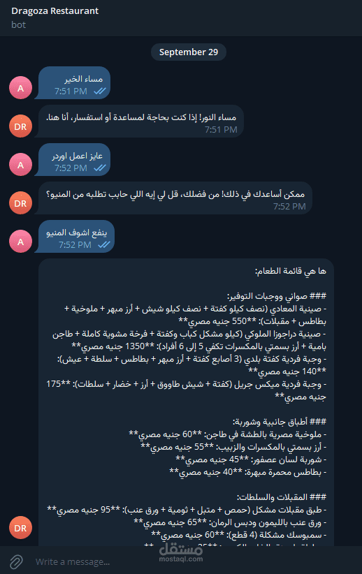
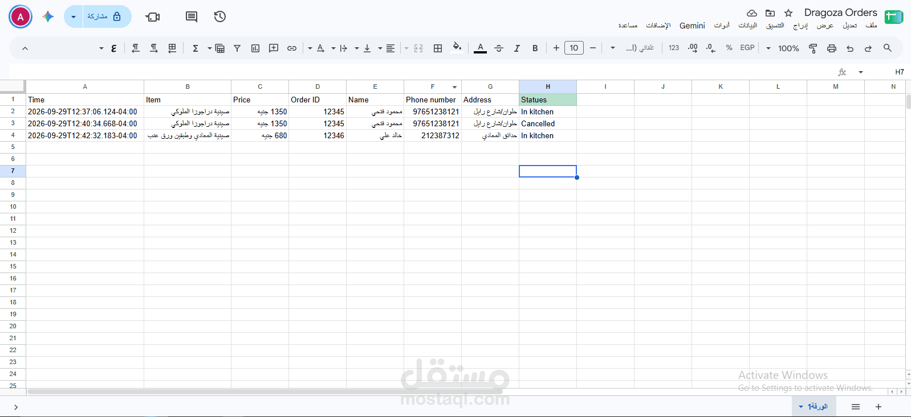
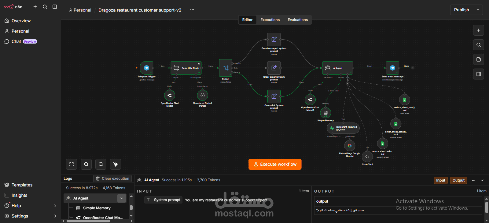
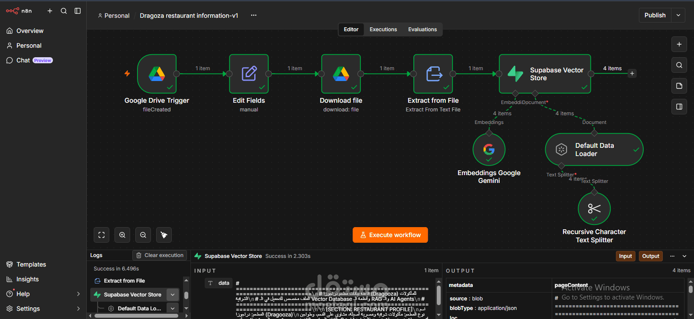
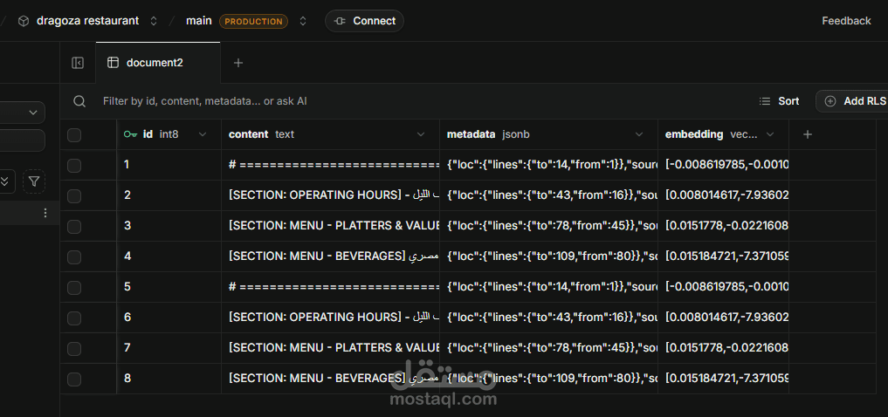
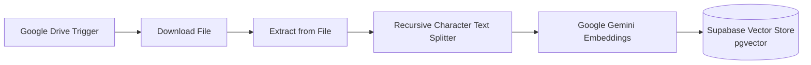
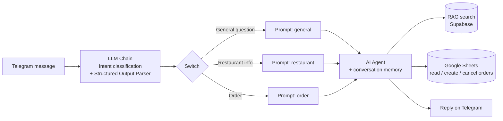

# 🍽️ Dragoza Restaurant: AI Customer Service Agent (n8n + RAG + Telegram)

An end-to-end AI customer service system for **Dragoza**, an Egyptian oriental restaurant. Customers talk to a Telegram bot that answers questions from the restaurant's real data and manages orders in Google Sheets, with no human involved.


## 📸 Demo

| Telegram bot | Order logged in Google Sheets |
|---|---|
|  |  |

### Workflows

**Customer support AI Agent**



**Knowledge base ingestion (RAG pipeline)**



**Chunks and embeddings stored in Supabase (pgvector)**



## 🎯 The problem

Restaurants lose time answering the same questions (menu, prices, opening hours) and taking orders by hand. This project automates both, and answers **only from the restaurant's own data** to avoid made-up prices or items.

## 🏗️ How it works

The system is made of **two n8n workflows**.

### 1. Knowledge base pipeline (RAG ingestion)
`Dragoza restaurant information v1`



Whenever a new data file is added to a watched Google Drive folder (menu, prices, working hours, FAQs), the workflow extracts the text, splits it into chunks (1500 characters, 20 overlap), converts the chunks to vectors with **Google Gemini Embeddings**, and stores them in **Supabase (pgvector)**.

### 2. Customer support bot
`Dragoza restaurant customer support v2`



1. **Intent classification**: an LLM Chain with a Structured Output Parser decides if the message is a general question, a restaurant inquiry, or an order.
2. **Routing**: a Switch node sends it to the matching prompt.
3. **AI Agent** with tools:
   - 🔎 **RAG search** over the Supabase knowledge base (menu, prices, hours)
   - 📖 **Read orders** from Google Sheets
   - 📝 **Create orders** in Google Sheets
   - ❌ **Cancel orders** in Google Sheets
4. **Conversation memory** keeps context for each customer across messages.

## ✨ Features

- Answers menu, price and working-hours questions using the real restaurant data (RAG)
- Handles the full order flow: create, check and cancel
- Understands Egyptian Arabic messages
- Keeps conversation context per customer
- Knowledge base updates automatically when a new file is added to the Google Drive folder

## 🧰 Tech stack

| Layer | Tool |
|---|---|
| Automation | n8n |
| LLM | OpenRouter, Google Gemini |
| Embeddings | Google Gemini Embeddings |
| Vector database | Supabase (pgvector) |
| Orders storage | Google Sheets |
| Knowledge source | Google Drive |
| Interface | Telegram Bot API |

## 📁 Repository structure

```
dragoza-restaurant-ai-agent/
├── README.md
├── dragoza-restaurant-information-v1.json
├── dragoza-restaurant-customer-support-v2.json
├── ai-agent.png
├── knowledge-base.png
├── supabase-chunking.png
├── telegram-demo.png
└── google-sheets-orders.png
```
## ⚙️ Setup

1. **Import the workflows**: in n8n, go to *Workflows → Import from file* and import both JSON files from the repository root. Re-select your own Google Drive folder, Google Sheet and credentials in the nodes (IDs in the files are placeholders).
2. **Create the credentials** in n8n:
   - Telegram Bot token (from [@BotFather](https://t.me/BotFather))
   - Google Gemini API key
   - OpenRouter API key
   - Supabase URL and service key
   - Google Drive and Google Sheets OAuth
3. **Prepare Supabase**: enable the `pgvector` extension, create the vector table `document2` (columns: `id`, `content`, `metadata`, `embedding`) and the matching function `match_document2` used by the Supabase Vector Store node.
4. **Create a Google Sheet** for orders with these exact column headers: `Time`, `Item`, `Price`, `Order ID`, `Name`, `Phone number`, `Address`, `Statues` (the workflow writes to `Statues`, so keep the spelling as is).
5. **Upload your restaurant data** to the Google Drive folder watched by the first workflow, and activate it.
6. **Activate the support workflow** and message your bot on Telegram.

## 🔒 Notes

- No API keys or tokens are stored in this repository.
- The restaurant and customer data shown are sample data for demonstration.

## 👤 Author

**Adham Ahmed Abbas**, AI Automation Engineer
[GitHub](https://github.com/adhmabbas) · [LinkedIn](https://www.linkedin.com/in/adham-ahmed-abbas-ai) · adhamabass2020@gmail.com
